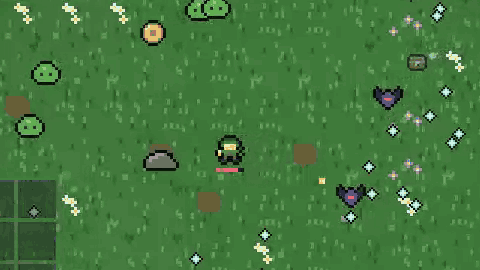

Ahoj, jsem **Daliik**. Stavím Minecraft server **[Arconia](https://arconia.cz)**: od pluginů v Javě přes bosse a dungeony až po web. Když zrovna nekóduju server, dělám hry do prohlížeče.

## RuGee

**Survivors hra v prohlížeči.** Hýbeš se jen ty, zbraně střílí samy a hordy nekončí.
14 zbraní bez stropu úrovní, bossové každé 3 minuty, 6 map a čisté HTML, CSS a JavaScript bez enginu.

**[▶ Hrát](https://kojdad-alt.github.io/RuGee/)** · [repozitář](https://github.com/kojdad-alt/RuGee)

## Arconia

<table>
<tr>
<td width="50%" valign="top">

**Heroes & Dungeons** – RPG režim

- 10 krajů s dungeony, od Elfího lesa po Magický kraj
- bossové s fázemi a schopnostmi
- kovárna s 280+ recepty, gemy a elementy
- úrovně 1–100 s medailemi

</td>
<td width="50%" valign="top">

**SkyRealm** – SMP s ostrovy

- vlastní bedny, Černý trh a duely
- eventy a sezónní mapy
- vlastní okna a tooltipy
- web [arconia.cz](https://arconia.cz) s obchodem a žebříčky

</td>
</tr>
</table>

## Technologie

mc.arconia.cz · arconia.cz

